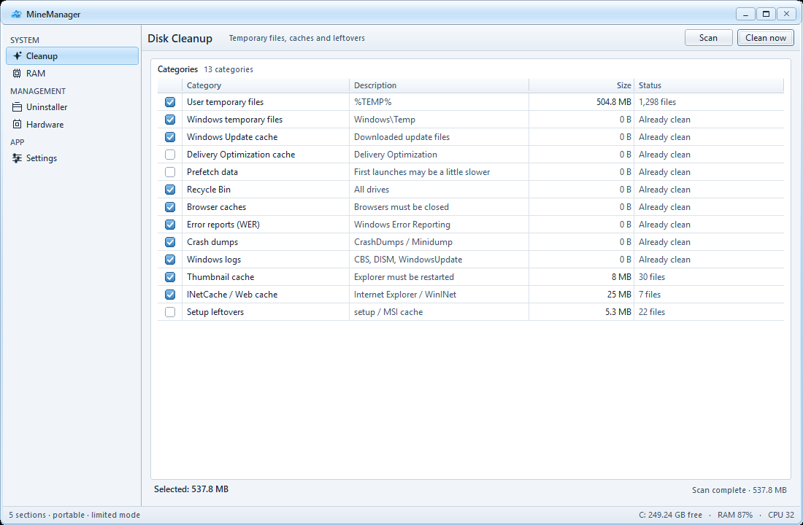
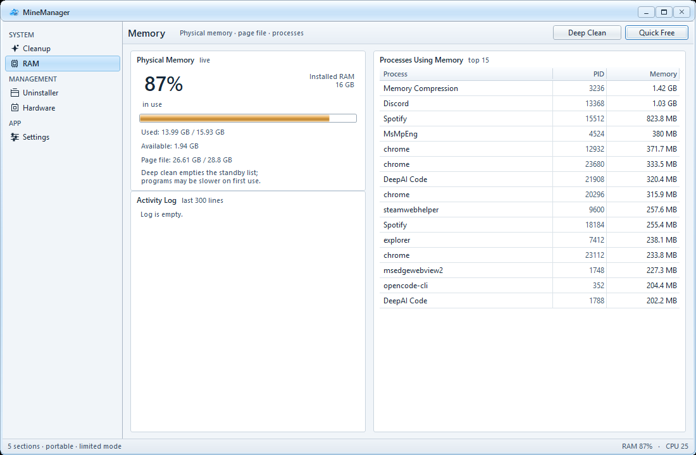
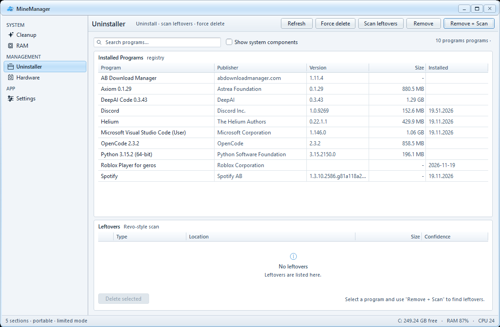
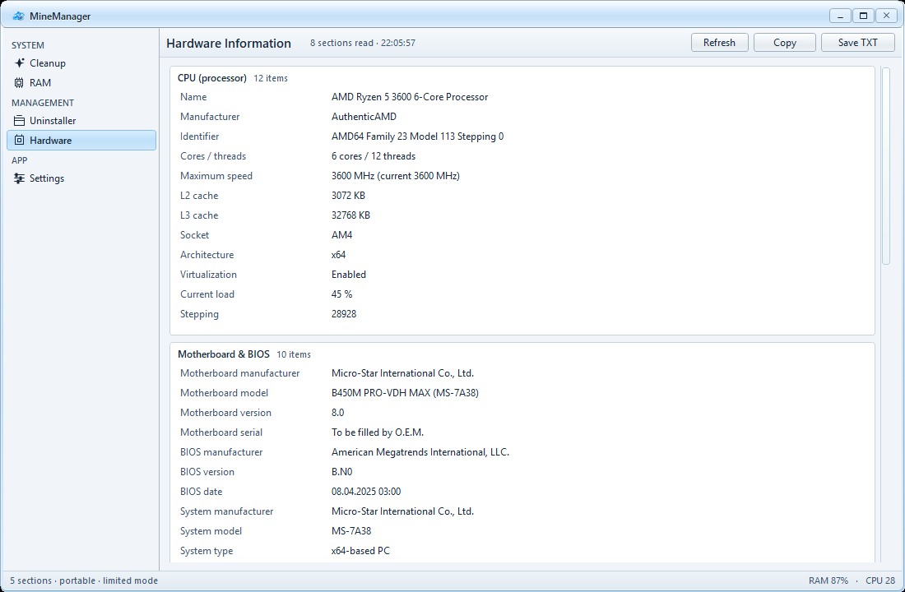
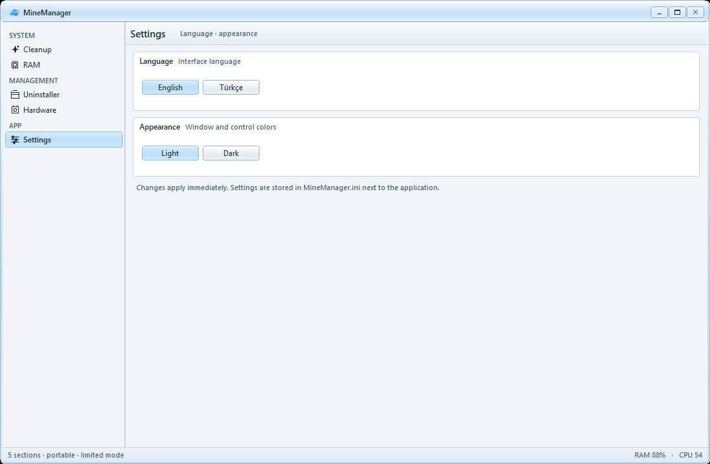
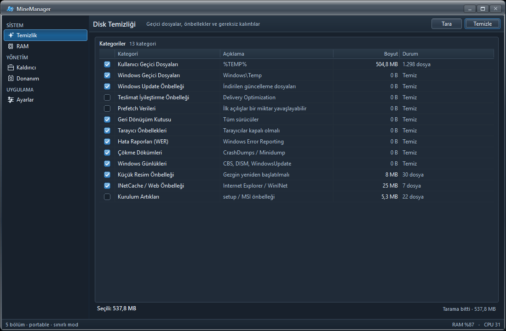

# MineManager

<p align="center">
  
</p>

<p align="center">
  <a href="https://github.com/expires0n/minemanager/releases/latest"></a>
  <a href="https://github.com/expires0n/minemanager/actions/workflows/release.yml"></a>
  
  <a href="LICENSE"></a>
  
  
  
</p>

A single-EXE, install-free Windows system tool: **PC Manager + Bulk Crap Uninstaller + CPU-Z +
WinUtil** style features in one Aero-themed window — cleanup, RAM, uninstaller, tweaks, config
and hardware information.

> ### 🚧 Public beta — actively developed
>
> MineManager already does the work described below, but it is **not finished**. Pages, tweak and
> config catalogues and localisations will keep growing, and behaviour, labels and on-disk formats
> can still change between beta releases.
>
> - **Scope expands every release** — startup/service managers, cleanup profiles, disk analyzer,
>   driver inventory and more are on the [roadmap](ROADMAP.md).
> - **Data grows every release** — cleanup categories, tweaks and config actions are catalogue-driven
>   and the counts in this README are a snapshot of `v0.9.0`.
> - **More languages are coming** — English and Turkish ship today.
> - **Expect rough edges.** Please open an [issue](https://github.com/expires0n/minemanager/issues)
>   with your Windows build, the page and what you expected.
>
> Read the confirmation dialogs, back up what matters, and follow [CHANGELOG.md](CHANGELOG.md) for
> changes and [ROADMAP.md](ROADMAP.md) for what is next.

[**English**](#english) · [**Türkçe**](#tr) · [**Download**](https://github.com/expires0n/minemanager/releases/latest)

---

<a id="english"></a>

# English

> This README is written in English by default. The application UI is also English by default and
> can be switched to Turkish at runtime (Settings → Language).

## Contents

- [Overview](#overview)
- [At a glance](#at-a-glance)
- [Project status](#project-status)
- [Screenshots](#screenshots)
- [Quick start](#quick-start)
- [Pages](#pages)
  - [1. Cleanup](#1-cleanup)
  - [2. RAM](#2-ram)
  - [3. Uninstaller](#3-uninstaller)
  - [4. Tweaks](#4-tweaks)
  - [5. Config](#5-config)
  - [6. Hardware](#6-hardware)
  - [7. Settings](#7-settings)
- [Safety model](#safety-model)
- [Technical](#technical)
- [Build](#build)
- [Data pipeline](#data-pipeline)
- [Verification](#verification)
- [Project layout](#project-layout)
- [Known limits](#known-limits)
- [Third-party sources and licences](#third-party-sources-and-licences)
- [Documentation](#documentation)

## Overview

MineManager is a portable Windows utility for people who want one small tool instead of five
installers. It targets **Windows 10/11** (the Aero theme also renders on Windows 7, where only the
registry-based features are meaningful).

- **One file.** `dist\MineManager.exe`, ~615 KB, `anycpu`, no DLLs, no runtime to install.
- **Two languages, two themes.** English (default) + Turkish, light Aero + dark graphite Aero.
  Every visible string is localised; a missing translation falls back to English.
- **Elevated by manifest** (`requireAdministrator`) because it writes system folders and registry.
  When elevation is refused the app still starts; actions that need admin are disabled and say why.
- **Portable settings.** `MineManager.ini` next to the EXE; if that folder is read-only it falls
  back to `%APPDATA%\MineManager\settings.ini`.
- **Nothing is downloaded at runtime.** No updater, no third-party binaries, no telemetry.
- **Reversible by design.** Registry deletions are exported first; tweaks snapshot the real current
  values before writing; every long operation is cancellable and confirmed.

## At a glance

| | |
|---|---|
| Binary | `dist\MineManager.exe` — single file, ~615 KB, portable |
| Runtime | .NET Framework 4.8 (in-box on Windows 10/11) |
| UI | English (default) + Turkish; light/dark Aero; custom-drawn |
| Pages | 7 |
| Cleanup categories | 13 |
| Tweaks | 67 — 18 essential · 22 advanced · 25 preferences · 2 performance plans |
| Config actions | 32 — 9 features · 6 fixes · 14 legacy panels · 2 profile · 1 remote |
| Uninstaller | registry union (HKLM 64-bit, `WOW6432Node`, HKCU), 6 detected installer families |
| Concurrency | one long job at a time; language/theme switching is blocked while it runs |

## Project status

**Beta, actively developed.** The shipped build covers the whole workflow described below, but it
is not feature-complete and it is not frozen.

| | |
|---|---|
| Current stage | Public beta (`v0.9.0`); the project stays beta until 1.0 |
| Scope | Every release adds tools and pages; see the [roadmap](ROADMAP.md) |
| Catalogues | Cleanup categories, tweaks and config actions keep growing; counts here are a snapshot |
| Languages | English + Turkish now; German, Spanish and Dutch are planned |
| Compatibility | Windows 10/11 are the target; the Aero theme still renders on Windows 7 |
| Stability | Interfaces and local file formats can change between beta releases |
| Feedback | [Issues](https://github.com/expires0n/minemanager/issues) and pull requests are welcome |

## Screenshots

Light Aero, English:

| Cleanup | RAM | Uninstaller |
|---|---|---|
|  |  |  |

| Hardware | Settings | Turkish, dark |
|---|---|---|
|  |  |  |

The full set — both themes, both languages, 320 px layouts, dialogs and toasts — is in
[`design-system/minemanager/screens/`](design-system/minemanager/screens).

## Quick start

1. Download `MineManager-<version>-portable.zip` from
   [Releases](https://github.com/expires0n/minemanager/releases/latest), extract it anywhere
   (USB stick, desktop, a tools folder) and run `MineManager.exe` — or build it yourself with
   `build.bat`.
2. Accept the UAC prompt.
3. Pick a page in the left navigation.
4. Optional: Settings → Language → **Türkçe** if you prefer Turkish.

There is nothing to install and nothing to uninstall: delete the folder (and the optional
`MineManager.ini`, `MineManager.undo.tsv`, `MineManager-backup\` the app creates next to it).

## Pages

### 1. Cleanup

Thirteen categories are scanned in the background; size and file count are shown per category and
you choose what to delete.

| Category | Content |
|---|---|
| User temporary files | `%TEMP%`, `AppData\Local\Temp` |
| Windows temporary files | `C:\Windows\Temp` |
| Windows Update cache | `SoftwareDistribution\Download` |
| Delivery Optimization | Delivery Optimization cache *(off by default)* |
| Prefetch | `C:\Windows\Prefetch` *(off — the next launches get slower)* |
| Recycle Bin | All drives (`SHQueryRecycleBin` / `SHEmptyRecycleBin`) |
| Browser caches | Chrome, Edge, Brave, Vivaldi, Yandex, Opera, Opera GX, Firefox |
| Error reports | WER ReportQueue / ReportArchive / Temp |
| Crash dumps | CrashDumps, Minidump, LiveKernelReports |
| Windows logs | CBS, DISM, WindowsUpdate, SIH |
| Thumbnail cache | `thumbcache_*.db`, `iconcache_*.db` |
| INetCache | WinINet / Internet Explorer cache |
| Setup leftovers | Panther, Downloaded Installations, `$PatchCache$` *(off)* |

Files in use are skipped silently and scheduled for deletion on the next boot with
`MoveFileEx(MOVEFILE_DELAY_UNTIL_REBOOT)`; the error count is shown in the **Status** column.

### 2. RAM

- Live memory readout: percentage, used/available, page file, installed RAM.
- **Quick Free:** `EmptyWorkingSet` on every accessible process (a test run freed 3.1 GB → 5.6 GB).
- **Deep Clean:** takes `SeProfileSingleProcessPrivilege` and clears the modified page list, the
  standby list and the low-priority standby list via `NtSetSystemInformation`. Needs admin; when
  not elevated the log says so instead of failing silently.
- Top 15 memory consumers, a 1-second live counter and an activity log.

### 3. Uninstaller

The engine was rewritten from [Bulk Crap Uninstaller](https://github.com/BCUninstaller/Bulk-Crap-Uninstaller)
concepts (Apache-2.0). See `docs/KAYNAK-DEGERLENDIRME.md` for the full evaluation.

- Programs are read from HKLM 64-bit, `WOW6432Node` and HKCU Uninstall keys, with search,
  system-component/update hiding, size and install date.
- **Type column:** Msiexec, Inno Setup, NSIS, InstallShield, SdbInst or PowerShell — detected from
  the uninstaller itself (Inno `.dat` log, NSIS "Nullsoft" signature, MSI product code).
- **Remove:** runs the program's own uninstaller (`msiexec /I...` is rewritten to `/X...`).
- **Remove + Scan / Scan leftovers / Force delete:** the existing flows are unchanged.
- **Remove selected:** a checkbox column feeds a **strictly sequential** queue with progress and a
  **Stop** button, so MSI error 1618 (another installation in progress) cannot happen.
- **Quiet** is **off every session**. Turning it on shows a confirmation dialog that lists each
  program with its exact command line and defaults to Cancel. Silent commands are only generated
  for MSI (`/X{GUID} /qn /norestart`), Inno Setup (`/VERYSILENT /SUPPRESSMSGBOXES /NORESTART`) and
  NSIS (`/S`); everything else opens its normal uninstaller. `SystemComponent` and `NoRemove`
  entries are never silently removed.
- **Invalid entries:** if the uninstaller file is missing the row is flagged and removal is blocked;
  **Remove entry** exports the key with `reg export` first and then deletes only that key.
- **Details:** publisher, version, install folder/source, registry path, product code, both command
  lines.
- **Export CSV:** UTF-8 with BOM, quote escaping and a `= + - @` formula guard.

**Before deleting registry data:** keys are exported with `reg.exe export` into
`MineManager-backup\<timestamp>\` next to the EXE, as `.reg` files you can double-click to restore.
File/folder deletions are not backed up.

### 4. Tweaks

Built from the [WinUtil](https://github.com/ChrisTitusTech/winutil) (MIT) tweak catalogue:
**18 essential, 22 advanced (CAUTION), 25 preferences, 2 performance plans** — **67 tweaks**.
The catalogue is generated into `src/TweaksData.cs` from `tools/data/winutil-tweaks.json`.

- Left column: grouped check lists (Essential / Advanced). The advanced group is locked until
  "I understand — enable advanced tweaks" is ticked.
- Right column: **Customize Preferences** switches (applied immediately) and **Performance Plans**
  buttons (`powercfg /duplicatescheme` · `/restoredefaultschemes`).
- Every row shows a state badge (**Applied / Not applied / Mixed**) and an `i` info button.
  State is probed in the background from registry values, services and scheduled tasks; the UI
  never blocks.
- **Run Tweaks** and **Undo Selected** show a plan first (e.g. `SET HKLM\...\X = 1 (DWord) [now: 0]`)
  in a confirmation dialog. Advanced tweaks use the destructive-styled dialog.
- **Undo restores the real previous value.** Before the first write, current values are snapshotted
  into `MineManager.undo.tsv` next to the EXE; WinUtil's `OriginalValue` is only a fallback.
  `<RemoveEntry>` deletes the value, never the key. Snapshot rows are validated against the compiled
  catalogue, so a tampered file cannot make the elevated app write arbitrary values.
- If a registry/service/task step fails, the applied steps are rolled back in reverse order. A
  script failure or timeout rolls those steps back but never auto-runs `UndoScript`.
- **No runtime downloads.** WinUtil tweaks that need a download (O&O ShutUp10++) or a picker UI
  (DNS selector) were not ported; the Adobe block list that WinUtil fetches over HTTP is a built-in
  list now.

### 5. Config

WinUtil's Config tab, adapted — **9 features, 6 fixes, 14 legacy panels, PowerShell profile,
OpenSSH**:

- **Features:** .NET Framework (2/3/4), Hyper-V, Legacy Media Components (WMP/DirectPlay), WSL,
  NFS, Windows Sandbox, Registry Backup (built-in periodic backup) and Legacy F8 Boot Recovery
  enable/disable. Installed state is read from DISM; **Install Features** runs
  `dism /online /enable-feature` and reports 3010 as "restart required".
- **Fixes:** AutoLogon, Network reset (`netsh winsock reset` / `int ip reset`, after saving
  `netsh -c interface dump`), NTP server (`w32tm … pool.ntp.org`), System corruption scan
  (`chkdsk /scan` → `dism /restorehealth` → `sfc /scannow`), Windows Update reset (stop services,
  rename `SoftwareDistribution` and `catroot2` with a timestamp, always restart services),
  WinGet repair.
- **Legacy Windows Panels:** Computer Management, Control Panel, Mouse Properties, Network
  Connections, Power Panel, Printer Panel, Programs and Features, Region, Security and Maintenance,
  Sound Settings, System Properties, Time and Date, Windows Defender Firewall, Windows Restore.
- **PowerShell profile:** writes a small, commented starter profile to
  `Documents\PowerShell` and `Documents\WindowsPowerShell`; an existing file is backed up with a
  timestamp and only a file whose **first line** is the MineManager marker is replaced or deleted.
- **Remote access:** OpenSSH Server capability + `sshd` service + a firewall rule scoped to
  `sshd.exe` on private/domain networks only.

Deliberate deviations from WinUtil: **no Sysinternals `Autologon.exe` download** (the Winlogon
registry method is used, no password is collected, the plain-text warning and `netplwiz` are shown),
WinGet is repaired in place with `Reset-AppxPackage` instead of reinstalling via Chocolatey, and the
CTT profile is replaced by a small local profile.

### 6. Hardware

WMI + registry in eight sections: CPU (cores/threads, socket, L2/L3, virtualisation, live load,
stepping) · Motherboard & BIOS · Memory (per-module type/speed/vendor/part number) · GPU (real VRAM,
resolution, driver) · Storage (disks + drive usage) · OS (build, uptime) · Network · Other.

**Copy** and **Save TXT** export the report.

### 7. Settings

- **Language:** English (default) / Türkçe. Applied to the whole UI immediately.
- **Appearance:** Light / Dark. The dark palette is graphite Aero; glass, gloss, grids and scroll
  bars are all repainted.
- Changes apply instantly and are stored under `[ui]` in `MineManager.ini`.

## Safety model

| Area | Behaviour |
|---|---|
| Registry deletion | `reg.exe export` into `MineManager-backup\<timestamp>\` before anything is deleted |
| Tweak undo | real value snapshot in `MineManager.undo.tsv`, validated against the compiled catalogue |
| Quiet uninstall | off by default; confirmation lists every exact command line; Cancel is the default |
| Invalid uninstall entries | flagged, uninstall blocked, key removal is backed up first |
| Elevation | manifest requires admin; non-elevated sessions get disabled actions with the reason |
| One job at a time | uninstall queue, tweak batch and config actions share a single job guard |
| Closing while busy | the window asks before closing during a running job |
| Language/theme switch | blocked while a job runs, so state cannot be lost mid-operation |
| Downloads | none, ever; no updater and no telemetry |
| Irreversible actions | "Force delete" and temp-file cleanup are permanent and say so before running |

## Technical

- **C# 5 / WinForms, .NET Framework 4.8**, compiled with the in-box
  `C:\Windows\Microsoft.NET\Framework64\v4.0.30319\csc.exe`. No SDK, no NuGet, no external DLLs.
- **Single EXE**, ~615 KB, `anycpu`, no dependencies.
- **Two languages, two themes:** English default + Turkish; light Aero + dark graphite Aero.
  `src/Lang.cs` (core dictionary) plus per-feature fragments `LangUninstall`, `LangTweaks`,
  `LangTweaksUi`, `LangConfig`; theme in `src/Theme.cs`, `src/AeroDark.cs`, `src/AppSettings.cs`.
- **Windows 7 Aero look, fully custom-painted:** glass frame + 30 px title bar, Explorer nav pane,
  gloss buttons (23 px), 22 px fields, 24 px detail rows, blue selection gradients, group-box cards,
  glass modal/toast, a 300-line ring-buffer console. Tokens live in
  `design-system/minemanager/tokens.json` → `aero-tokens.css`; the C# mirror is `src/Theme.cs`,
  the dark palette `src/AeroDark.cs`, primitives in `src/AeroControls.cs`, `src/AeroGrid.cs`,
  `src/AeroDialogs.cs`, `src/AeroScrollBar.cs`, `src/AeroToggle.cs`.
- **Manifest:** `requireAdministrator`, `longPathAware`, UTF-8 code page. Fatal startup errors use a
  plain system MessageBox so they render even if the theme failed to load.
- **No UI stalls:** scanning, cleaning, uninstalling, DISM and tweak batches run on `Task`s and
  marshal back with `BeginInvoke`, always guarded by `IsHandleCreated && !IsDisposed`.
- **Process runner (`src/ProcRunner.cs`):** PowerShell blocks are written to
  `%TEMP%\MineManager\*.ps1` and run with `-NoProfile -ExecutionPolicy Bypass -File` (no
  `-EncodedCommand`), output is captured line by line, `Sysnative` is used from a 32-bit process,
  and a timed-out tree is closed with `taskkill /T /F`. `timeoutSec < 0` means "no deadline", used
  for `msiexec` so a slow MSI is never killed mid-transaction.
- **Tweak engine (`src/TweakEngine.cs`):** registry/service/task detection, plan preview,
  pre-write snapshot, reverse rollback, PowerShell last, and post-write verification — a tweak only
  counts as applied when `Detect` confirms it.
- **Config engine (`src/ConfigEngine.cs`):** DISM feature states (cached, locale-tolerant) and one
  handler per fix; every step is logged and every failure becomes a localised message.
- **Uninstall queue (`src/Uninstaller.cs`):** strict sequence, 10-minute timeout for NSIS/Inno only,
  no timeout for MSI, exit-code mapping (1605 gone, 1602 skipped, 1618 busy, 1641/3010 reboot),
  no automatic reboot, and success for NSIS/Inno confirmed by polling that the registry key
  disappeared.
- **Single instance:** `Global\MineManager.SingleInstance.v1` mutex (falls back to a per-session
  mutex when the account cannot create a global object).
- **Logo:** `assets/logo.png` is the single source; `tools/make_icon.py` produces the 16–256 px
  `assets/app.ico` and the embedded `assets/logo64.png`, used in the title bar, dialog captions and
  as the EXE/taskbar icon.

## Build

```
build.bat
```

Uses the in-box .NET Framework 4.8 compiler; no SDK is required. If `assets\app.ico` or
`assets\logo64.png` is missing, `tools\make_icon.py` (pure Python, from `assets\logo.png`) creates
it first. Output: `dist\MineManager.exe`.

The equivalent command line is:

```
csc /target:winexe /platform:anycpu /optimize+ /codepage:65001 ^
    /win32icon:assets\app.ico ^
    /resource:assets\logo64.png,MineManager.Resources.logo.png ^
    /win32manifest:src\app.manifest ^
    /out:dist\MineManager.exe ^
    /r:System.dll /r:System.Core.dll /r:System.Drawing.dll ^
    /r:System.Windows.Forms.dll /r:System.Management.dll ^
    /recurse:src\*.cs
```

Python is only needed for the icon pipeline and the tweak-data generator; the application itself
has no Python dependency.

Portable release package (EXE + README + LICENSE + NOTICE, zipped):

```
powershell -ExecutionPolicy Bypass -File packaging\make-portable.ps1 -Version v0.9.0
```

It writes `MineManager-v0.9.0-portable.zip` and prints the SHA-256 plus the ready-to-run
`gh release create` command. Attach that zip to every GitHub release.

## Data pipeline

```
tools/data/winutil-tweaks.json     vendored WinUtil config/tweaks.json
            │
            ├── tools/gen_winutil.py ──► src/TweaksData.cs   (TweakCatalog, 67 tweaks)
            │                            generated, deterministic, do not hand-edit
            └── src/TweakEngine.cs      executes the generated catalog
```

`python tools/gen_winutil.py` re-emits `src/TweaksData.cs` with the same content (verified by
checksum). The generator refuses to emit if a tweak would download something at runtime or if a
preference tweak has no registry pair. `src/ConfigData.cs` (features, fixes, panels, profile,
remote) is curated by hand because most WinUtil entries there are shell commands, not data.

## Verification

- `build.bat` → **0 errors, 0 warnings**; `dist\MineManager.exe` is ~628 KB (under 1 MB).
- `tests/Smoke.cs` renders the real `MainForm` off-screen in **112 combinations** — 7 pages ×
  4 widths (1100/940/620/320) × English/Turkish × light/dark — and writes PNGs, so layout,
  clipping, theme and translation regressions are visible without clicking through the app.
  Build it with `-main:MineManager.Smoke`; it is not part of the shipped EXE.
- Language audit: **520** distinct English keys, **9** intentionally untranslated (product names such
  as "Inno Setup", "NSIS", "Windows Installer", and separator-only strings).
- Tweak engine self-check: catalog counts (18/22/25/2), no null titles/scripts, no download tokens,
  real HKCU apply → detect → undo round trip, snapshot-over-default restore, rollback after a
  failing step, batch continues past a failure, cancel stops between items.
- Uninstaller self-check: command splitting, quiet synthesis per family, type detection on synthetic
  files, invalid-entry backup + key deletion, CSV BOM/escaping, queue exit-code handling.
- The manual checklist (each page, both languages, both themes, 320 px) lives at the end of
  `docs/KAYNAK-DEGERLENDIRME.md`.

## Project layout

```
src/            all source
                Theme, AeroDark, DarkMode, AppSettings, AeroLogo, AeroToggle,
                AeroControls, AeroGrid, AeroDialogs, AeroScrollBar, Native, ProcRunner, Sift,
                Lang + LangUninstall/LangTweaks/LangTweaksUi/LangConfig,
                Cleaner, FileTools, MemoryTools, Hardware, Uninstaller, LeftoverScanner,
                TweakEngine, TweaksData, ConfigData, ConfigEngine,
                MainForm, Program, pages/
assets/         logo.png (source), app.ico (16–256), logo64.png (embedded title icon)
tools/          make_icon.py (logo → ico/png), gen_winutil.py (WinUtil JSON → TweaksData.cs),
                data/winutil-tweaks.json (vendored data)
tests/          Smoke.cs (off-screen UI check, not shipped)
docs/           KAYNAK-DEGERLENDIRME.md (BCU + WinUtil evaluation, safety review, checklist)
design-system/  Aero tokens (tokens.json → aero-tokens.css, light + dark), MASTER.md, screens/
dist/           compiled single file (not committed; released as a portable zip)
.github/        release workflow: v* tag → build → portable zip → pre-release
packaging/      make-portable.ps1 (build + zip), release notes and the readme inside the zip
CHANGELOG.md    version history
ROADMAP.md      what is planned next
LICENSE/NOTICE  MIT licence and third-party attribution
```

## Known limits

- Browser caches can only be deleted while the browsers are closed; open files are skipped.
- The hardware panel's vertical scroll bar is the custom `AeroScrollBar`; native child scroll bars of
  grids and consoles are themed through `DarkMode.cs`. `SaveFileDialog` is drawn by the OS. Dark
  native scroll-bar theming requires Windows 10 1809+; on Windows 7 system drawing stays as-is.
- Minimum window size is 320×560. Tables scroll horizontally below ~534 px, the RAM page stacks
  below 760 px, navigation collapses to icons below 620 px, hardware cards stack labels/values below
  460 px.
- "Force delete" is irreversible: the registry is backed up, files are permanently deleted.
- Leftover scanning is heuristic; review the list before deleting.
- **Store (UWP) apps are not listed** — WinRT package management does not fit the single-EXE/C# 5
  target.
- Silent uninstall commands are only generated for MSI, Inno Setup and NSIS; other programs open
  their own UI and get no timeout in the queue.
- Tweaks target Windows 10/11; on Windows 7 only registry-based tweaks are meaningful. The undo
  snapshot lives in `MineManager.undo.tsv`; deleting it falls back to WinUtil's defaults.
- Feature installation, SFC/DISM and BCD changes need administrator rights; in a non-elevated session
  the buttons are disabled and the reason is shown.
- Over-the-shoulder UAC (elevating with another account's credentials) makes per-user actions apply
  to the elevating account's profile; this is not detected.
- Language/theme switching is blocked while a job runs; selections survive the page rebuild through
  `TweakSession`.

## Third-party sources and licences

- **Bulk Crap Uninstaller** — Apache-2.0, © Marcin Szeniak and contributors. Installer-type
  detection, quiet-uninstall rules and the Sift4 name-similarity logic were adapted; no file is a
  verbatim copy.
- **Windows Utility (WinUtil)** — MIT, © Chris Titus Tech. Tweak and feature data derive from
  `config/tweaks.json` and `config/feature.json`; generated files carry the source and licence
  header.
- Neither project is part of MineManager; they are adaptation sources only.

## Licence

MineManager is released under the [MIT License](LICENSE) — use it, fork it, ship it, keep the
copyright notice. Adapted third-party concepts and data are credited in [NOTICE](NOTICE) and in the
section above.

## Documentation

- `docs/KAYNAK-DEGERLENDIRME.md` — source-by-source evaluation (what was ported, what was rejected
  and why), the security review findings and their fixes, and the verification checklist.
- `design-system/minemanager/MASTER.md` — Aero design decisions and the accessibility checklist.
- `design-system/minemanager/aero-tokens.css` — design tokens shared by the C# theme.

---

<a id="tr"></a>

# Türkçe

> Bu README varsayılan olarak İngilizce yazılmıştır; Türkçe sürüm aşağıdadır. Uygulama arayüzü de
> varsayılan olarak İngilizcedir, Ayarlar → Dil bölümünden **Türkçe**'ye geçilebilir.

> ### 🚧 Herkese açık beta — aktif geliştiriliyor
>
> MineManager aşağıda anlatılan işleri bugün yapıyor, ancak **bitmiş değil**. Sayfalar, tweak ve
> yapılandırma katalogları ile diller sürekli genişleyecek; davranış, etiketler ve diskteki dosya
> biçimleri beta sürümleri arasında değişebilir.
>
> - **Kapsam her sürümde büyüyor** — başlangıç/hizmet yöneticileri, temizlik profilleri, disk
>   analizi, sürücü envanteri ve daha fazlası [yol haritasında](ROADMAP.md).
> - **Veri her sürümde büyüyor** — temizlik kategorileri, tweak'ler ve yapılandırma öğeleri katalog
>   tabanlıdır; bu README'deki sayılar `v0.9.0` anlık görüntüsüdür.
> - **Yeni diller geliyor** — bugün İngilizce ve Türkçe var.
> - **Pürüzler olabilir.** Windows sürümünüzü, sayfayı ve beklediğiniz davranışı yazarak
>   [issue](https://github.com/expires0n/minemanager/issues) açın.
>
> Onay pencerelerini okuyun, önemli verilerinizi yedekleyin; değişiklikler için
> [CHANGELOG.md](CHANGELOG.md), sırada ne olduğu için [ROADMAP.md](ROADMAP.md) dosyalarına bakın.

## İçindekiler

- [Genel bakış](#tr-genel)
- [Bir bakışta](#tr-bakis)
- [Proje durumu](#tr-durum)
- [Ekran görüntüleri](#tr-ekran)
- [Hızlı başlangıç](#tr-hizli)
- [Sayfalar](#tr-sayfalar)
  - [1. Temizlik](#tr-temizlik)
  - [2. RAM](#tr-ram)
  - [3. Kaldırıcı](#tr-kaldirici)
  - [4. İnce Ayarlar](#tr-tweaks)
  - [5. Yapılandırma](#tr-config)
  - [6. Donanım](#tr-donanim)
  - [7. Ayarlar](#tr-ayarlar)
- [Güvenlik modeli](#tr-guvenlik)
- [Teknik](#tr-teknik)
- [Derleme](#tr-derleme)
- [Veri üretimi](#tr-veri)
- [Doğrulama](#tr-dogrulama)
- [Proje düzeni](#tr-duzen)
- [Bilinen sınırlar](#tr-sinirlar)
- [Kaynaklar ve lisanslar](#tr-lisans)
- [Belgeler](#tr-belgeler)

<a id="tr-genel"></a>

## Genel bakış

MineManager, beş ayrı kurulum yerine tek bir küçük araç isteyenler için taşınabilir bir Windows
sistem aracıdır. Hedef **Windows 10/11**'dir (Aero teması Windows 7'de de çizilir; orada yalnızca
kayıt defteri tabanlı özellikler anlamlıdır).

- **Tek dosya.** `dist\MineManager.exe`, ~615 KB, `anycpu`, DLL yok, çalışma zamanı kurulumu yok.
- **İki dil, iki tema.** İngilizce (varsayılan) + Türkçe, açık Aero + koyu graphite Aero.
  Görünen her metin yerelleştirilmiştir; eksik çeviri İngilizceye düşer.
- **Manifest ile yönetici** (`requireAdministrator`) — sistem klasörlerine ve kayıt defterine yazar.
  Yükseltme reddedilirse uygulama yine açılır; yönetici gerektiren eylemler kapalıdır ve nedeni yazılır.
- **Taşınabilir ayarlar.** EXE'nin yanındaki `MineManager.ini`; klasör salt okunursa
  `%APPDATA%\MineManager\settings.ini`.
- **Çalışma anında hiçbir şey indirilmez.** Güncelleyici, üçüncü taraf ikili dosya ve telemetri yok.
- **Tasarım gereği geri alınabilir.** Kayıt defteri silmeleri önce dışa aktarılır, tweak'ler gerçek
  mevcut değerleri yazmadan önce saklar, uzun işlemler onay ister ve iptal edilebilir.

<a id="tr-bakis"></a>

## Bir bakışta

| | |
|---|---|
| Dosya | `dist\MineManager.exe` — tek dosya, ~615 KB, portable |
| Çalışma zamanı | .NET Framework 4.8 (Windows 10/11'de hazır) |
| Arayüz | İngilizce (varsayılan) + Türkçe; açık/koyu Aero; tamamen özel çizim |
| Sayfa | 7 |
| Temizlik kategorisi | 13 |
| Tweak | 67 — 18 temel · 22 gelişmiş · 25 tercih · 2 performans planı |
| Yapılandırma öğesi | 32 — 9 özellik · 6 onarım · 14 klasik panel · 2 profil · 1 uzak erişim |
| Kaldırıcı | kayıt defteri birleşimi (HKLM 64-bit, `WOW6432Node`, HKCU), 6 kurulum ailesi tespiti |
| Eşzamanlılık | aynı anda tek uzun işlem; iş sürerken dil/tema değişimi kilitli |

<a id="tr-durum"></a>

## Proje durumu

**Beta, aktif geliştiriliyor.** Yayınlanan derleme aşağıdaki iş akışının tamamını kapsıyor, ancak
özellikleri tamamlanmış ve dondurulmuş değil.

| | |
|---|---|
| Aşama | Herkese açık beta (`v0.9.0`); proje 1.0'a kadar beta kalır |
| Kapsam | Her sürüm yeni araç ve sayfa ekler; [yol haritasına](ROADMAP.md) bakın |
| Kataloglar | Temizlik kategorileri, tweak'ler ve yapılandırma öğeleri büyümeye devam eder; buradaki sayılar anlık görüntüdür |
| Diller | Şimdilik İngilizce + Türkçe; Almanca, İspanyolca ve Hollandaca planlanıyor |
| Uyumluluk | Hedef Windows 10/11; Aero teması Windows 7'de de çizilir |
| Kararlılık | Arayüzler ve yerel dosya biçimleri beta sürümleri arasında değişebilir |
| Geri bildirim | [Issue](https://github.com/expires0n/minemanager/issues) ve pull request'ler açıktır |

<a id="tr-ekran"></a>

## Ekran görüntüleri

Açık Aero, İngilizce:

| Temizlik | RAM | Kaldırıcı |
|---|---|---|
|  |  |  |

| Donanım | Ayarlar | Türkçe, koyu |
|---|---|---|
|  |  |  |

Tam set — iki tema, iki dil, 320 px yerleşimler, pencereler ve toast'lar —
[`design-system/minemanager/screens/`](design-system/minemanager/screens) altında.

<a id="tr-hizli"></a>

## Hızlı başlangıç

1. [Releases](https://github.com/expires0n/minemanager/releases/latest) sayfasından
   `MineManager-<sürüm>-portable.zip` dosyasını indirin, istediğiniz yere açın (USB bellek,
   masaüstü, araç klasörü) ve `MineManager.exe` dosyasını çalıştırın — veya `build.bat` ile kendiniz
   derleyin.
2. UAC onayını verin.
3. Sol gezinmeden bir sayfa seçin.
4. İsteğe bağlı: Ayarlar → Dil → **Türkçe**.

Kurulacak bir şey yok; kaldırmak için klasörü (ve yanında oluşan isteğe bağlı `MineManager.ini`,
`MineManager.undo.tsv`, `MineManager-backup\` klasörünü) silmek yeterli.

<a id="tr-sayfalar"></a>

## Sayfalar

<a id="tr-temizlik"></a>

### 1. Temizlik

On üç kategori arka planda taranır; kategori başına boyut ve dosya sayısı gösterilir, neyin
silineceğini siz seçersiniz.

| Kategori | İçerik |
|---|---|
| Kullanıcı geçici dosyaları | `%TEMP%`, `AppData\Local\Temp` |
| Windows geçici dosyaları | `C:\Windows\Temp` |
| Windows Update önbelleği | `SoftwareDistribution\Download` |
| Teslimat İyileştirme | Delivery Optimization önbelleği *(varsayılan kapalı)* |
| Prefetch | `C:\Windows\Prefetch` *(kapalı — sonraki açılışlar yavaşlar)* |
| Geri Dönüşüm Kutusu | Tüm sürücüler (`SHQueryRecycleBin` / `SHEmptyRecycleBin`) |
| Tarayıcı önbellekleri | Chrome, Edge, Brave, Vivaldi, Yandex, Opera, Opera GX, Firefox |
| Hata raporları | WER ReportQueue / ReportArchive / Temp |
| Çökme dökümleri | CrashDumps, Minidump, LiveKernelReports |
| Windows günlükleri | CBS, DISM, WindowsUpdate, SIH |
| Küçük resim önbelleği | `thumbcache_*.db`, `iconcache_*.db` |
| INetCache | WinINet / Internet Explorer önbelleği |
| Kurulum artıkları | Panther, Downloaded Installations, `$PatchCache$` *(kapalı)* |

Kullanımda olan dosyalar sessizce atlanır ve bir sonraki açılışta silinmek üzere
`MoveFileEx(MOVEFILE_DELAY_UNTIL_REBOOT)` ile işaretlenir; hata sayısı **Durum** sütununda görünür.

<a id="tr-ram"></a>

### 2. RAM

- Canlı bellek göstergesi: yüzde, kullanılan/kullanılabilir, sayfa dosyası, kurulu RAM.
- **Hızlı Boşalt:** tüm erişilebilir süreçlerde `EmptyWorkingSet` (testte 3,1 GB → 5,6 GB boşaldı).
- **Derin Temizlik:** `SeProfileSingleProcessPrivilege` alıp `NtSetSystemInformation` ile
  değiştirilmiş sayfa listesini, bekleme (standby) listesini ve düşük öncelikli bekleme listesini
  temizler. Yönetici izni gerekir; yönetici değilse günlüğe nedeni yazılır.
- En çok bellek kullanan 15 süreç, 1 saniyelik canlı sayaç ve işlem günlüğü.

<a id="tr-kaldirici"></a>

### 3. Kaldırıcı

Motor, [Bulk Crap Uninstaller](https://github.com/BCUninstaller/Bulk-Crap-Uninstaller) (Apache-2.0)
kavramlarıyla yeniden yazıldı. Ayrıntılı değerlendirme: `docs/KAYNAK-DEGERLENDIRME.md`.

- Programlar HKLM 64-bit, `WOW6432Node` ve HKCU Uninstall anahtarlarından okunur; arama, sistem
  bileşeni/güncelleme gizleme, boyut ve kurulum tarihi vardır.
- **Tür** sütunu: Msiexec, Inno Setup, NSIS, InstallShield, SdbInst veya PowerShell — kaldırıcının
  kendisinden tespit edilir (Inno `.dat` günlüğü, NSIS "Nullsoft" imzası, MSI ürün kodu).
- **Kaldır:** programın kendi kaldırıcısını çalıştırır (`msiexec /I...` otomatik `/X...` yapılır).
- **Kaldır + Tara / Kalıntı Tara / Zorla Sil:** mevcut akışlar korunur.
- **Seçilenleri Kaldır:** onay kutusu sütunu, ilerleme ve **Durdur** düğmesi olan **sıralı** bir
  kuyruğa bağlanır; böylece MSI 1618 (başka kurulum sürüyor) hatası oluşmaz.
- **Sessiz** her oturumda **kapalı** başlar. Açıldığında onay penceresi her programın **tam komut
  satırını** listeler ve varsayılan düğme İptal'dir. Sessiz komut yalnızca MSI
  (`/X{GUID} /qn /norestart`), Inno Setup (`/VERYSILENT /SUPPRESSMSGBOXES /NORESTART`) ve NSIS
  (`/S`) için üretilir; diğerleri kendi arayüzleriyle açılır. `SystemComponent` ve `NoRemove`
  kayıtları asla sessiz kaldırılmaz.
- **Geçersiz kayıtlar:** kaldırıcı dosyası yoksa satır işaretlenir ve kaldırma engellenir;
  **Remove entry** önce `reg export` ile yedek alır, sonra yalnızca o anahtarı siler.
- **Ayrıntılar:** yayıncı, sürüm, kurulum klasörü/kaynağı, kayıt yolu, ürün kodu ve iki komut satırı.
- **CSV Dışa Aktar:** UTF-8 BOM, tırnak kaçışı ve `= + - @` formül koruması.

**Kayıt defteri silinmeden önce:** anahtarlar `reg.exe export` ile EXE'nin yanındaki
`MineManager-backup\<tarih-saat>\` klasörüne `.reg` olarak yedeklenir; dosyaya çift tıklayıp geri
yükleyebilirsiniz. Dosya/klasör silmeleri yedeklenmez.

<a id="tr-tweaks"></a>

### 4. İnce Ayarlar

[WinUtil](https://github.com/ChrisTitusTech/winutil) (MIT) tweak kataloğundan üretilir:
**18 temel, 22 gelişmiş (DİKKAT), 25 tercih, 2 performans planı** — toplam **67 tweak**.
Katalog `tools/data/winutil-tweaks.json` dosyasından `src/TweaksData.cs` içine üretilir.

- Sol sütun: gruplu onay listeleri (Temel / Gelişmiş). Gelişmiş grup, "Anladım — gelişmiş ayarları
  etkinleştir" işaretlenene kadar kilitlidir.
- Sağ sütun: **Tercihleri Özelleştir** açma/kapama anahtarları (anında uygulanır) ve
  **Performans Planları** düğmeleri (`powercfg /duplicatescheme` · `/restoredefaultschemes`).
- Her satırda durum rozeti (**Uygulandı / Uygulanmadı / Karma**) ve `i` bilgi düğmesi vardır.
  Durum arka planda kayıt defteri, hizmetler ve zamanlanmış görevlerden okunur; arayüz donmaz.
- **Ayarları Uygula** ve **Seçilenleri Geri Al** önce yapılacak işlemlerin listesini
  (örn. `SET HKLM\...\X = 1 (DWord) [now: 0]`) onay penceresinde gösterir. Gelişmiş tweak'lerde
  onay "yıkıcı" olarak işaretlenir.
- **Geri alma gerçek önceki değeri kurtarır.** İlk yazmadan önce mevcut değerler EXE'nin yanındaki
  `MineManager.undo.tsv` dosyasına anlık görüntü olarak kaydedilir; WinUtil'ın `OriginalValue`
  değeri yalnızca yedek yoldur. `<RemoveEntry>` değeri siler, anahtarı **silmez**. Anlık görüntü
  satırları derlenmiş katalogla doğrulanır; dosyayı değiştiren biri yükseltilmiş uygulamaya keyfî
  değer yazdıramaz.
- Kayıt defteri/hizmet/görev adımı başarısız olursa uygulanan adımlar ters sırayla geri alınır.
  Betik adımı hata verir veya zaman aşımına uğrarsa bu adımlar geri alınır ama `UndoScript`
  otomatik çalıştırılmaz.
- **Çalışma anında indirme yok.** WinUtil'ın indirme gerektiren (O&O ShutUp10++) veya seçim kutusu
  isteyen (DNS seçici) tweak'leri taşınmadı; WinUtil'ın HTTP ile çektiği Adobe engel listesi artık
  yerleşik bir listedir.

<a id="tr-config"></a>

### 5. Yapılandırma

WinUtil'ın Config sekmesinin uyarlaması — **9 özellik, 6 onarım, 14 klasik panel, PowerShell
profili, OpenSSH**:

- **Özellikler:** .NET Framework (2/3/4), Hyper-V, Eski Medya Bileşenleri (WMP/DirectPlay), WSL,
  NFS, Windows Sandbox, Kayıt Defteri Yedeği (yerleşik periyodik yedekleme) ve Eski F8 Önyükleme
  Kurtarma aç/kapat. Kurulu durum DISM'den okunur; **Özellikleri Kur** `dism /online /enable-feature`
  çalıştırır ve 3010 kodunu "yeniden başlatma gerekli" olarak raporlar.
- **Onarımlar:** AutoLogon, Ağ sıfırlama (`netsh -c interface dump` yedeğinden sonra
  `netsh winsock reset` / `int ip reset`), NTP sunucusu (`w32tm … pool.ntp.org`), Sistem bozulma
  taraması (`chkdsk /scan` → `dism /restorehealth` → `sfc /scannow`), Windows Update sıfırlama
  (hizmetleri durdur, `SoftwareDistribution` ve `catroot2` klasörlerini zaman damgasıyla yeniden
  adlandır, hizmetleri **her durumda** yeniden başlat), WinGet onarımı.
- **Klasik Windows Panelleri:** Bilgisayar Yönetimi, Denetim Masası, Fare Özellikleri, Ağ
  Bağlantıları, Güç Paneli, Yazıcı Paneli, Programlar ve Özellikler, Bölge, Güvenlik ve Bakım,
  Ses Ayarları, Sistem Özellikleri, Saat ve Tarih, Windows Defender Güvenlik Duvarı,
  Windows Geri Yükleme.
- **PowerShell profili:** `Documents\PowerShell` ve `Documents\WindowsPowerShell` altına küçük,
  yorumlu bir başlangıç profili yazar; var olan dosya zaman damgalı olarak yedeklenir ve yalnızca
  **ilk satırı** MineManager işareti olan dosya değiştirilir/silinir.
- **Uzak erişim:** OpenSSH Server yeteneği + `sshd` hizmeti + yalnızca `sshd.exe` ve özel/etki alanı
  ağları için güvenlik duvarı kuralı.

WinUtil'dan bilinçli sapmalar: Sysinternals `Autologon.exe` **indirilmez** (Winlogon kayıt defteri
yöntemi kullanılır, parola istenmez/saklanmaz, düz metin uyarısı ve `netplwiz` gösterilir), WinGet
Chocolatey ile yeniden kurulmak yerine `Reset-AppxPackage` ile yerinde onarılır, CTT profilinin
tamamı yerine küçük bir yerel profil yazılır.

<a id="tr-donanim"></a>

### 6. Donanım

WMI + kayıt defteri ile sekiz bölüm: İşlemci (çekirdek/iş parçacığı, soket, L2/L3, sanallaştırma,
anlık yük, stepping) · Anakart & BIOS · Bellek (modül modül tip/hız/üretici/parça no) · Ekran kartı
(gerçek VRAM, çözünürlük, sürücü) · Depolama (diskler + sürücü doluluğu) · İşletim sistemi (build,
çalışma süresi) · Ağ · Diğer.

**Kopyala** ve **TXT Kaydet** ile raporu dışa aktarabilirsiniz.

<a id="tr-ayarlar"></a>

### 7. Ayarlar

- **Dil:** English (varsayılan) / Türkçe. Seçim anında tüm arayüze uygulanır.
- **Görünüm:** Light / Dark. Koyu palet graphite Aero'dur; cam, gloss, tablolar ve kaydırma
  çubukları dahil tüm yüzeyler yeniden boyanır.
- Değişiklikler anında uygulanır ve `MineManager.ini` içinde `[ui]` altında saklanır.

<a id="tr-guvenlik"></a>

## Güvenlik modeli

| Alan | Davranış |
|---|---|
| Kayıt defteri silme | Silmeden önce `MineManager-backup\<tarih>\` klasörüne `reg.exe export` |
| Tweak geri alma | `MineManager.undo.tsv` içinde gerçek değer anlık görüntüsü, derlenmiş katalogla doğrulanır |
| Sessiz kaldırma | Varsayılan kapalı; onay her komut satırını listeler; varsayılan düğme İptal |
| Geçersiz kayıtlar | İşaretlenir, kaldırma engellenir, anahtar silinmeden önce yedek alınır |
| Yönetici | Manifest yönetici ister; yönetici olmayan oturumda eylemler kapalı ve nedeni yazılı |
| Aynı anda tek iş | Kaldırma kuyruğu, tweak toplu işlemi ve yapılandırma eylemleri tek iş kilidini paylaşır |
| İş sürerken kapatma | Pencere kapatılmadan önce onay ister |
| Dil/tema değişimi | İş sürerken kilitli; böylece işlem ortasında durum kaybolmaz |
| İndirme | Hiç yok; güncelleyici ve telemetri yok |
| Geri alınamaz işlemler | "Zorla Sil" ve geçici dosya temizliği kalıcıdır ve çalışmadan önce bunu söyler |

<a id="tr-teknik"></a>

## Teknik

- **C# 5 / WinForms, .NET Framework 4.8**, Windows ile gelen
  `C:\Windows\Microsoft.NET\Framework64\v4.0.30319\csc.exe` ile derlenir. SDK, NuGet ve harici DLL yok.
- **Tek EXE**, ~615 KB, `anycpu`, bağımlılık yok.
- **İki dil, iki tema:** İngilizce varsayılan + Türkçe; açık Aero + koyu graphite Aero.
  `src/Lang.cs` (çekirdek sözlük) ve özellik bazlı parçalar `LangUninstall`, `LangTweaks`,
  `LangTweaksUi`, `LangConfig`; tema `src/Theme.cs`, `src/AeroDark.cs`, `src/AppSettings.cs`.
- **Windows 7 Aero görünümü, tamamen özel çizim:** cam çerçeve + 30 px başlık çubuğu, Explorer
  gezinme paneli, gloss düğmeler (23 px), 22 px alanlar, 24 px ayrıntı satırları, mavi seçim
  gradyanları, group box kartlar, cam modal/toast, 300 satırlık halka tamponlu konsol. Tokenlar
  `design-system/minemanager/tokens.json` → `aero-tokens.css`; C# aynası `src/Theme.cs`, koyu palet
  `src/AeroDark.cs`, primitifler `src/AeroControls.cs`, `src/AeroGrid.cs`, `src/AeroDialogs.cs`,
  `src/AeroScrollBar.cs`, `src/AeroToggle.cs`.
- **Manifest:** `requireAdministrator`, `longPathAware`, UTF-8 kod sayfası. Ölümcül başlangıç
  hataları sistem MessageBox'ı ile gösterilir (tema yüklenemese bile görünsün diye).
- **Arayüz donmaz:** tarama, temizleme, kaldırma, DISM ve tweak toplu işlemleri `Task` üzerinde
  çalışır; UI'a `BeginInvoke` ile dönülür ve her çağrı `IsHandleCreated && !IsDisposed` ile korunur.
- **Süreç yürütme (`src/ProcRunner.cs`):** PowerShell blokları `%TEMP%\MineManager\*.ps1` dosyasına
  yazılıp `-NoProfile -ExecutionPolicy Bypass -File` ile çalıştırılır (`-EncodedCommand` yok), çıktı
  satır satır yakalanır, 32-bit süreçte `Sysnative` kullanılır, zaman aşımında süreç ağacı
  `taskkill /T /F` ile kapatılır. `timeoutSec < 0` "süre sınırı yok" demektir; `msiexec` için
  kullanılır, böylece yavaş bir MSI işlem ortasında öldürülmez.
- **Ayar motoru (`src/TweakEngine.cs`):** kayıt defteri/hizmet/görev tespiti, plan önizlemesi,
  yazma öncesi anlık görüntü, ters sıralı geri alma, betik adımı en sonda ve yazma sonrası doğrulama —
  bir tweak ancak `Detect` uygulandığını doğrularsa başarılı sayılır.
- **Yapılandırma motoru (`src/ConfigEngine.cs`):** DISM özellik durumları (önbellekli, dil bağımsız)
  ve her onarım için ayrı işleyici; her adım günlüğe yazılır, her hata yerelleştirilmiş iletiye dönüşür.
- **Kaldırma kuyruğu (`src/Uninstaller.cs`):** kesin sıra, yalnızca NSIS/Inno için 10 dakikalık
  zaman aşımı, MSI için zaman aşımı yok, çıkış kodu eşlemesi (1605 gitti, 1602 atlandı, 1618 meşgul,
  1641/3010 yeniden başlatma), otomatik yeniden başlatma yok, NSIS/Inno başarısı kayıt anahtarının
  kaybolması yoklanarak doğrulanır.
- **Tek örnek:** `Global\MineManager.SingleInstance.v1` mutex'i (hesap global nesne oluşturamazsa
  oturum bazlı mutex'e düşer).
- **Logo:** tek kaynak `assets/logo.png`; `tools/make_icon.py` 16–256 px `assets/app.ico` ve gömülü
  `assets/logo64.png` üretir. Başlık çubuğunda, modal başlığında ve EXE/taskbar simgesi olarak kullanılır.

<a id="tr-derleme"></a>

## Derleme

```
build.bat
```

Windows ile gelen .NET Framework 4.8 derleyicisi kullanılır; SDK gerekmez. `assets\app.ico` veya
`assets\logo64.png` yoksa önce `tools\make_icon.py` (saf Python, `assets\logo.png` kaynağından)
çalışır. Çıktı: `dist\MineManager.exe`.

Eşdeğer komut satırı:

```
csc /target:winexe /platform:anycpu /optimize+ /codepage:65001 ^
    /win32icon:assets\app.ico ^
    /resource:assets\logo64.png,MineManager.Resources.logo.png ^
    /win32manifest:src\app.manifest ^
    /out:dist\MineManager.exe ^
    /r:System.dll /r:System.Core.dll /r:System.Drawing.dll ^
    /r:System.Windows.Forms.dll /r:System.Management.dll ^
    /recurse:src\*.cs
```

Python yalnızca simge üretimi ve tweak verisi üreticisi için gerekir; uygulamanın Python bağımlılığı yoktur.

Portable sürüm paketi (EXE + README + LICENSE + NOTICE, zip):

```
powershell -ExecutionPolicy Bypass -File packaging\make-portable.ps1 -Version v0.9.0
```

`MineManager-v0.9.0-portable.zip` dosyasını üretir; SHA-256 özetini ve doğrudan çalıştırılacak
`gh release create` komutunu yazar. Her GitHub sürümüne bu zip eklenir.

<a id="tr-veri"></a>

## Veri üretimi

```
tools/data/winutil-tweaks.json     alınan WinUtil config/tweaks.json
            │
            ├── tools/gen_winutil.py ──► src/TweaksData.cs   (TweakCatalog, 67 tweak)
            │                            üretilen dosya, deterministik, elle düzenlenmez
            └── src/TweakEngine.cs      üretilen kataloğu çalıştırır
```

`python tools/gen_winutil.py` aynı içeriği yeniden üretir (sağlama toplamıyla doğrulandı). Üretici,
çalışma anında indirme yapacak bir tweak veya kayıt defteri çifti olmayan bir tercih tweak'i
kalırsa dosyayı yazmayı reddeder. `src/ConfigData.cs` (özellikler, onarımlar, paneller, profil,
uzak erişim) elle hazırlanmıştır çünkü WinUtil'daki karşılıkları veri değil kabuk komutlarıdır.

<a id="tr-dogrulama"></a>

## Doğrulama

- `build.bat` → **0 hata, 0 uyarı**; `dist\MineManager.exe` = 628.224 bayt (< 1 MB).
- `tests/Smoke.cs` gerçek `MainForm`'u ekran dışında **112 kombinasyonda** çizer — 7 sayfa ×
  4 genişlik (1100/940/620/320) × İngilizce/Türkçe × açık/koyu — ve PNG yazar; böylece düzen,
  taşma, tema ve çeviri hataları uygulamayı tıklamadan görünür. `-main:MineManager.Smoke` ile
  derlenir; üretilen EXE'ye dahil değildir.
- Çeviri denetimi: **520** farklı İngilizce anahtar, **9**'u bilinçli olarak çevrilmedi (Inno Setup,
  NSIS, Windows Installer gibi ürün adları ve yalnızca ayırıcı içeren dizeler).
- Ayar motoru öz denetimi: katalog sayıları (18/22/25/2), boş başlık/betik yok, indirme belirteci yok,
  gerçek HKCU uygula → algıla → geri al turu, varsayılan yerine anlık görüntüden geri yükleme,
  başarısız adımdan sonra geri alma, toplu işte hata sonrası devam, iptalde öğeler arasında durma.
- Kaldırıcı öz denetimi: komut ayrıştırma, aile başına sessiz komut üretimi, sentetik dosyalarda tür
  tespiti, geçersiz kaydın yedeklenip silinmesi, CSV BOM/kaçış, kuyruk çıkış kodu davranışı.
- Elle kontrol listesi (her sayfa, iki dil, iki tema, 320 px) `docs/KAYNAK-DEGERLENDIRME.md` sonunda.

<a id="tr-duzen"></a>

## Proje düzeni

```
src/            tüm kaynak
                Theme, AeroDark, DarkMode, AppSettings, AeroLogo, AeroToggle,
                AeroControls, AeroGrid, AeroDialogs, AeroScrollBar, Native, ProcRunner, Sift,
                Lang + LangUninstall/LangTweaks/LangTweaksUi/LangConfig,
                Cleaner, FileTools, MemoryTools, Hardware, Uninstaller, LeftoverScanner,
                TweakEngine, TweaksData, ConfigData, ConfigEngine,
                MainForm, Program, pages/
assets/         logo.png (kaynak), app.ico (16–256), logo64.png (gömülü başlık ikonu)
tools/          make_icon.py (logo → ico/png), gen_winutil.py (WinUtil JSON → TweaksData.cs),
                data/winutil-tweaks.json (alınan veri)
tests/          Smoke.cs (ekran dışı UI kontrolü; dağıtılan EXE'ye dahil değil)
docs/           KAYNAK-DEGERLENDIRME.md (BCU + WinUtil değerlendirmesi, güvenlik incelemesi, liste)
design-system/  Aero tokenları (tokens.json → aero-tokens.css, açık + koyu), MASTER.md, screens/
dist/           derlenmiş tek dosya (depoda tutulmaz; portable zip olarak yayınlanır)
.github/        release iş akışı: v* etiketi → derleme → portable zip → pre-release
packaging/      make-portable.ps1 (derleme + zip), sürüm notları ve zip içindeki beni-oku
CHANGELOG.md    sürüm geçmişi
ROADMAP.md      sıradaki planlar
LICENSE/NOTICE  MIT lisansı ve üçüncü taraf atıfları
```

<a id="tr-sinirlar"></a>

## Bilinen sınırlar

- Tarayıcı önbellekleri yalnızca tarayıcılar kapalıyken silinebilir; açık dosyalar atlanır.
- Donanım panelinin dikey kaydırma çubuğu özel `AeroScrollBar`'dır; tablo ve konsolların yerel çocuk
  çubukları `DarkMode.cs` ile temalanır. `SaveFileDialog` işletim sistemi tarafından çizilir. Koyu
  yerel kaydırma çubuğu teması Windows 10 1809+ ile sınırlıdır; Windows 7'de sistem çizimi korunur.
- Pencere minimumu 320×560. Tablolar ~534 px altında yatay kaydırılır, RAM sayfası 760 px altında
  dikey yığılır, gezinme 620 px altında simge moduna daralır, donanım kartları 460 px altında
  etiket/değeri alt alta yığar.
- "Zorla Sil" geri alınamaz: kayıt defteri yedeklenir, dosyalar kalıcı silinir.
- Kalıntı taraması sezgiseldir; silmeden önce listeyi gözden geçirin.
- **Store (UWP) uygulamaları listelenmez** — WinRT paket yönetimi tek EXE/C# 5 hedefiyle uyumsuz.
- Sessiz kaldırma komutu yalnızca MSI, Inno Setup ve NSIS için üretilir; diğer programlar kendi
  arayüzlerini açar ve kuyrukta zaman aşımı uygulanmaz.
- Tweak'ler Windows 10/11 hedeflidir; Windows 7'de yalnızca kayıt defteri tabanlı olanlar anlamlıdır.
  Geri alma anlık görüntüsü `MineManager.undo.tsv` dosyasındadır; silinirse WinUtil varsayılanlarına
  düşülür.
- Özellik kurulumu, SFC/DISM ve BCD değişiklikleri yönetici ister; yönetici olmayan oturumda ilgili
  düğmeler kapalıdır ve nedeni yazılır.
- Over-the-shoulder UAC (başka hesabın bilgileriyle yükseltme) durumunda kullanıcı bazlı işlemler
  yükselten hesabın profiline uygulanır; bu durum tespit edilmez.
- Dil/tema değişimi iş sürerken kilitlidir; seçimler sayfa yeniden kurulsa da `TweakSession` ile korunur.

<a id="tr-lisans"></a>

## Lisans

MineManager [MIT Lisansı](LICENSE) ile yayınlanır — kullanabilir, fork'layabilir, dağıtabilirsiniz;
telif bildirimini koruyun. Uyarlanan üçüncü taraf fikirleri ve veriler [NOTICE](NOTICE) dosyasında ve
yukarıdaki bölümde belirtilmiştir.

<a id="tr-kaynaklar"></a>

## Kaynaklar ve lisanslar

- **Bulk Crap Uninstaller** — Apache-2.0, © Marcin Szeniak ve katkıda bulunanlar. Kurulum türü
  tespiti, sessiz kaldırma kuralları ve Sift4 isim benzerliği bu projeden uyarlanmıştır; hiçbir dosya
  birebir kopya değildir.
- **Windows Utility (WinUtil)** — MIT, © Chris Titus Tech. Tweak ve özellik verisi
  `config/tweaks.json` ile `config/feature.json` dosyalarından türetilmiştir; üretilen dosyaların
  başında kaynak ve lisans notu bulunur.
- İki proje de MineManager'ın parçası değildir; yalnızca uyarlama kaynağıdır.

<a id="tr-belgeler"></a>

## Belgeler

- `docs/KAYNAK-DEGERLENDIRME.md` — kaynak bazlı değerlendirme (neyin alındığı, neyin alınmadığı ve
  neden), güvenlik incelemesi bulguları ve düzeltmeleri, doğrulama kontrol listesi.
- `design-system/minemanager/MASTER.md` — Aero tasarım kararları ve erişilebilirlik kontrol listesi.
- `design-system/minemanager/aero-tokens.css` — C# temasıyla paylaşılan tasarım tokenları.
